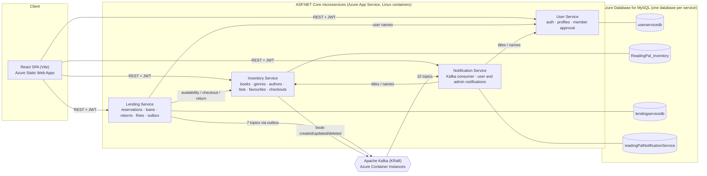
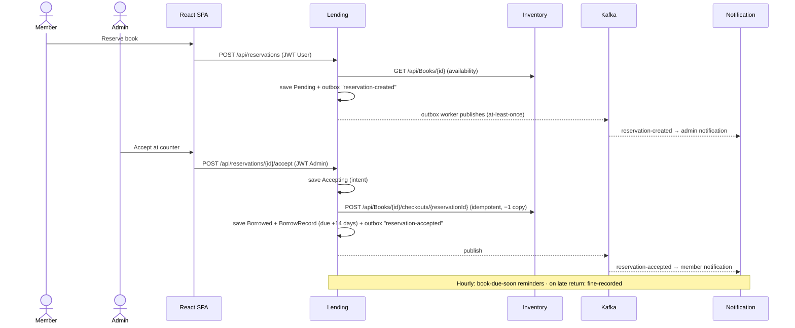
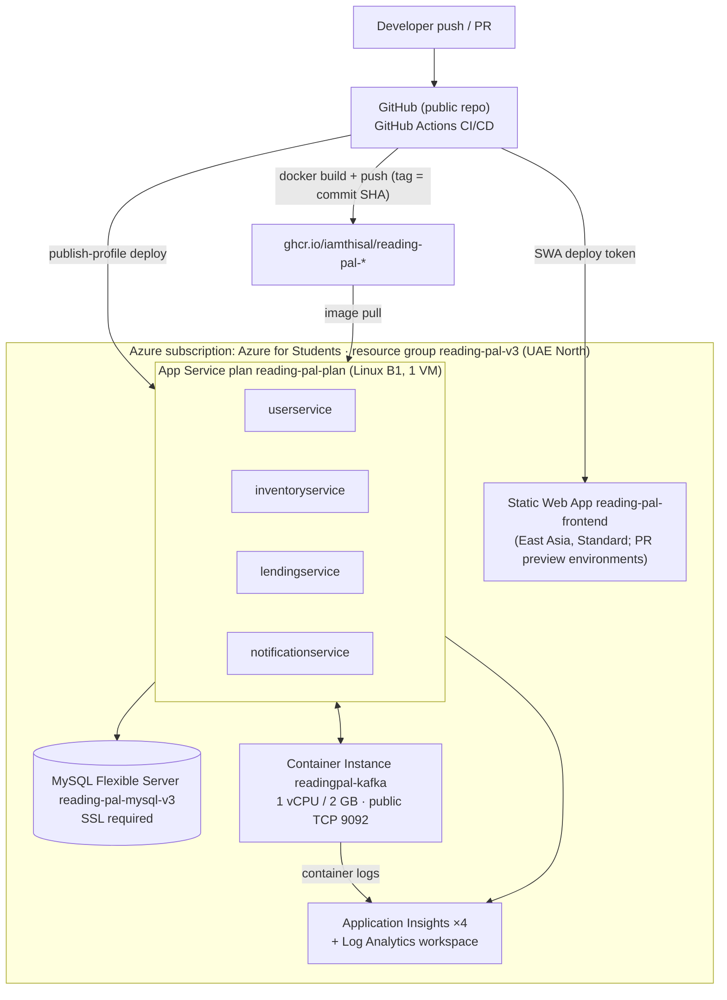
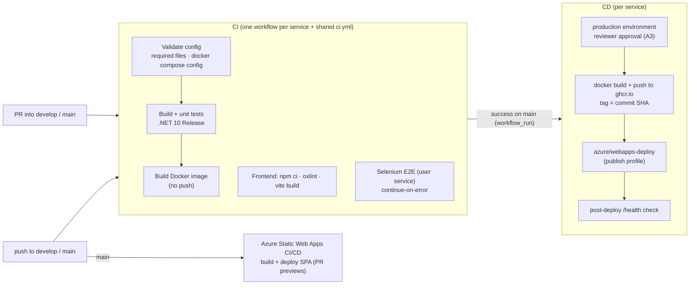

# Reading Pal — Final Evaluation Report (research draft)

**SE3022 Case Study Project · Year 3 Semester 1 · 2026**
**Draft compiled:** 16 October 2026 · **Code baseline:** `main` at `110f05d` (PR #99, merged 14 Oct 2026) · **Fix status updated:** 16 October 2026

This is the research draft for the Final Evaluation Document. It follows the template's structure (sections 1–9) so it can be moved into the `.docx` template section by section. Each section notes which rubric criterion it supports. Facts are tagged so you can see what has been checked:

- **[VERIFIED]** — checked on or before 16 Oct 2026 against the repository, GitHub, Azure, or the live site. The source is given.
- **[GAP]** — something the rubric's top band asks for that is missing or weak today. Each gap links to a fix in **Appendix A**.
- **[TODO-TEAM]** — information only the team can provide (IDs, Jira, video, sprint roles). These are collected in **Appendix B**.

> Do **not** commit real passwords into this file. The repository is public. Put the login credentials only into the submitted `.docx`.

---

## 0. Rubric coverage at a glance

| Rubric criterion (weight) | What the "Excellent" band asks for | Where this report covers it | Main gaps today |
|---|---|---|---|
| **1. Final product & deployment (20%)** | A robust, well-performing deployment; a compelling problem; value beyond the core requirements | §1, §2.4, §5.5, demo video | Leftover QA genres in production (A7) |
| **2. Architecture & deployment design (10%)** | Comprehensive architecture aligned with the code; deployment topology; scalability, monitoring, reliability, security | §2, §5.5 | No staging backend (A3: only the approval gate); remaining hardening (A8, A9) |
| **3. CI/CD pipeline (15%)** | Multi-stage pipeline with unit + integration tests, code analysis, secure deployment; reliable | §6 | Integration tests not run in CI; no code analysis; `continue-on-error` on Selenium; publish-profile deploys (A4) |
| **4. Documentation (10%)** | Coverage reports, JMeter results, Selenium E2E, **interactive Swagger UI**, well structured | §4, §7 | Swagger UI live only after the next release (A2); JMeter not yet run against Azure (A6) |

### Fix progress (16 Oct)

| Fix | Status | Where |
|---|---|---|
| **A1** Rotate the production secrets | **Done** (rotated and verified 16 Oct; code released in `db694ba`) | Azure app settings; PR **#100** |
| **A2** Swagger UI | **Done and live** (verified 17 Oct) | PR **#100**, released in **#103** |
| **A3** Staging / approval gate | **Done in code**, PR still to open. A repository admin must then add the required reviewers. | branch `ci/production-approval-gate` |
| **A4** Strengthen the pipeline | **Partly done.** The two failing user Selenium tests are fixed (released). The other A4 items are still open. | PR **#101** |
| **A5** Commit the QA artefacts | **Done** (merged) | PR **#101** |
| Kafka topics survive broker restarts | **Done** (merged) | PR **#102** |
| A6–A10 | Not started | — |

---

## Front matter (template page 1)

### Team details

| Field | Value |
|---|---|
| Team No | [TODO-TEAM] |
| Project Name | **Reading Pal — Library Management System** |

### Group members

The IDs and names below come from Git commit metadata. [TODO-TEAM] Confirm every row. The template has five rows; Git shows four contributors.

| Student ID | Name | Evidence |
|---|---|---|
| IT24101841 | Sakila Samaraweera | Commits as `sakilasamaraweera` / `it24101841@my.sliit.lk` |
| IT24101516 | Dahamya Kulandi (to confirm) | Commits as `DahamKu` / `it24101516@my.sliit.lk` and `DahamKu101`; the name appears on the live site's reservations |
| IT24101868 | (to confirm — GitHub `iamthisal`, email `thisaldilnath@…`) | Commits as `iamthisal` and `IT24101868` |
| [TODO-TEAM] | Dilum Peiris (to confirm) | Commits as `dilumpeiris` |

### Project links

| Link | Value |
|---|---|
| GitHub Repository | https://github.com/iamthisal/reading-pal **[VERIFIED]** (public) |
| JIRA | [TODO-TEAM] (project key **YRP**, per branch names) |
| Project Summary Video (≤ 3 min) | [TODO-TEAM] |
| Deployed Application | https://polite-water-0c0e68a00.3.azurestaticapps.net **[VERIFIED]** |

### Login credentials for the deployed application

| User role | Username | Password |
|---|---|---|
| Admin | Rotated on 16 Oct (A1). The new email and password are kept outside the repo and go into the `.docx` only. | in `.docx` only |
| Regular user (approved) | [TODO-TEAM] Recommend a dedicated evaluator account, not a team member's personal one | in `.docx` only |

The system has exactly two roles, `Admin` and `User` **[VERIFIED: `ProtectedRoute` `allowedRoles`, controller `[Authorize(Roles=…)]`]**. A newly registered user must be approved by an admin before they can reserve books, so the evaluator's user account must already be approved.

---

## 1. Project Overview  *(max 2 pages · rubric 1)*

### 1.1 Introduction
Reading Pal is a web application for a physical library. It keeps the library's book catalogue, reservations, loans, returns and fines in one place, and keeps members and librarians informed with in-app notifications. It is built as four ASP.NET Core microservices (User, Inventory, Lending, Notification), each with its own MySQL database. They communicate synchronously over REST and asynchronously through Apache Kafka. A React single-page application is the frontend, and everything is deployed to Microsoft Azure through GitHub Actions. *(Source: `specifications.md` §1–3; the code on `main`.)*

### 1.2 Problem statement
- **Members can't see availability without visiting.** Without a system, a member has to go to the library to find out whether a book is on the shelf.
- **Librarians track loans by hand.** Reservations, the copies on loan, due dates and overdue fines are tracked manually. That's error-prone: copies get double-counted, fines are inconsistent, and nobody has a view of who has what.
- **Nobody is told what's happening.** Members don't learn that a reservation is ready, that a due date is near, or that a fine was recorded. Librarians don't learn about new or cancelled reservations.

### 1.3 Objectives
1. Let members browse, search and filter the catalogue online and see real-time copy availability.
2. Let members reserve a book online and collect it at the counter. The admin accepts the reservation at the counter, which deducts exactly one copy.
3. Track loans with a 14-day loan period and calculate overdue fines automatically (LKR 10 per overdue calendar day, Asia/Colombo time). Payment is handled physically at the counter.
4. Give members and admins full borrowing history, current loans and fine totals.
5. Notify members and admins in the app of every relevant event: reservation accepted, rejected or cancelled; due-date reminder; return; fine recorded; new or deleted books; new and cancelled reservations for admins.
6. Meet the course's technical brief: at least four microservices, database per service, Kafka-based events, Docker, GitHub Actions CI/CD, Azure deployment, monitoring, and unit/E2E/performance testing.

### 1.4 Target users
| User | Needs | Main features *(all [VERIFIED] as routes on `main`)* |
|---|---|---|
| **Library member** (role `User`) | Find books, reserve, track loans and fines, get reminders | Discover/home, search (`/search`), book and author pages, favourites, My borrowings & fines, notifications, profile |
| **Librarian / admin** (role `Admin`) | Run the counter, approve members, manage the catalogue | Dashboard, pending/active users (approve, reject, revoke), book inventory and genres, authors, curated lists, pending reservations (accept/reject), borrowed books (return with fine), reservation history, admin notifications |

**Value beyond the core brief** (supports the rubric's "exceeds core requirements"):
- **Search:** relevance-ranked catalogue search with genre facets and paging.
- **Curation:** author pages and curated catalogue shelves (Recommended, Top 100, Popular authors), plus favourites.
- **Reliability:** an idempotent checkout ledger and a transactional outbox, so no copy is double-counted and no event is lost.
- **Notifications for admins:** per-admin notification read state, and admins are told about other admins' catalogue changes.

---

## 2. System Architecture  *(rubric 2)*

### 2.1 Architecture overview
- **Style:** microservices with a database per service. There are four ASP.NET Core Web APIs (.NET 10) plus a React SPA. **[VERIFIED: `services/*`, `docker-compose.yml`]**
- **Authentication and authorisation:** the User Service issues JWTs carrying a `role` claim (`User` or `Admin`). Every service validates the token itself and enforces role-based access per endpoint. **[VERIFIED: live checks on 16 Oct — no token → 401, wrong role → 403]**
- **Synchronous communication (REST):**
  - Lending calls Inventory to check availability before a reservation, and to **check out** or **return** a copy through idempotent, reservation-keyed endpoints.
  - Lending and Notification call User and Inventory to look up names and titles.
- **Asynchronous communication (Kafka):**
  - Lending publishes reservation, loan and fine events through a **transactional outbox**, so delivery is at least once.
  - Inventory publishes book events.
  - Notification consumes all **ten topics** and turns them into in-app notifications.
- **Data ownership:** each service owns its schema and applies its own EF Core migrations at startup.

### 2.2 Architecture iteration 1 — initial design (Aug–Sep 2026, `specifications.md`)
| Aspect | Initial design |
|---|---|
| Services | User, **Catalog**, **Borrowing**, Notification |
| Copy counts | Borrowing publishes `ReservationAccepted` / `BookReturned`; **Catalog consumes them** to decrement or increment copies |
| Reminders and fines | A **daily** scheduled job publishes `DueDateApproaching` / `FineInitiated` |
| Image registry | **Azure Container Registry (ACR)** |
| Kafka hosting | **Azure Container Apps** (planned with persistent storage); Event Hubs noted as the managed alternative |
| Monitoring | To be chosen from Prometheus+Grafana, ELK/EFK, or Application Insights |

### 2.3 Architecture iteration 2 — as built in Sprints 2–3 (User, Inventory, Lending)
| Aspect | Change |
|---|---|
| Naming | Catalog became **Inventory Service**; Borrowing became **Lending Service** |
| Copy counts | Moved from Kafka consumption to **synchronous, idempotent HTTP**. `POST /api/Books/{id}/checkouts/{reservationId}` and `…/return` on Inventory, backed by a `BookCheckouts` ledger keyed on the reservation ID. **[VERIFIED: `docs/lending-service.md`, `BooksController`]** |
| Event publishing | Lending uses a **transactional outbox** (`ReservationEvents` table plus a worker that runs every 5 s), so state changes and events are saved atomically and delivered at least once. **[VERIFIED: `ReservationOutboxWorker`]** |
| Registry | **GitHub Container Registry (ghcr.io)** instead of ACR. **[VERIFIED: CD workflows]** |
| Kafka hosting | **Azure Container Instances (ACI)**, single KRaft broker `cp-kafka:8.2.3`, public TCP 9092. **[VERIFIED: `az container show`]** |
| Monitoring | **Azure Application Insights**, one resource per service. **[VERIFIED]** |

### 2.4 Final architecture — Sprint 4 (adds Notification)

#### Component diagram


#### Data flow — reserve → accept → notify


#### Deployment topology  *(all [VERIFIED] with the Azure CLI on 14–16 Oct)*


| Resource | Name | Notes |
|---|---|---|
| Frontend | `reading-pal-frontend` (Static Web App, Standard) | `https://polite-water-0c0e68a00.3.azurestaticapps.net` |
| User / Inventory / Lending / Notification | `reading-pal-{user,inventory,lending,notification}service` | One B1 Linux plan; all run image `a1fc611`/`110f05d` from GHCR |
| Database | `reading-pal-mysql-v3` (Flexible Server) | `userservicedb`, `ReadingPal_inventory`, `lendingservicedb`, `readingPalNotificationService` |
| Event broker | `readingpal-kafka` (ACI) | `readingpal-kafka-grp13.uaenorth.azurecontainer.io:9092`; recreates its 10 topics on every start |
| Monitoring | 4 × Application Insights | One per service, shared Log Analytics workspace |

### 2.5 Justification of architectural changes
| Change | Reason | Status |
|---|---|---|
| Copy counts by **synchronous idempotent HTTP**, not a Kafka consumer | The admin at the counter needs an immediate, definite answer: was a copy allocated? A reservation-keyed ledger lets a retry never deduct twice. Using Kafka for the same counts risks double-counting. *(`docs/lending-service.md`: "Do not add a consumer that deducts/restores the same copies again.")* | [VERIFIED] |
| **Transactional outbox** in Lending | The state change and its event are saved in one database transaction, so nothing is lost when Kafka is down. This was proven in production on 14 Oct: after the broker lost its topics, the outbox delivered its backlog (22 snapshots, 5 reminders, etc.). | [VERIFIED] |
| **GHCR** instead of ACR | No extra Azure resource or cost. CD authenticates with the built-in `GITHUB_TOKEN`, and images sit next to the code. | Reason inferred — [TODO-TEAM] confirm |
| **ACI** instead of Container Apps for Kafka | Kafka needs raw TCP, which App Service can't proxy; ACI exposes TCP 9092 directly and bills per second (it can be stopped when idle). | ACI choice [VERIFIED]; why not Container Apps — [TODO-TEAM] |
| **Hourly** due-soon job instead of daily | Lending's reminder service checks hourly and queues a reminder two days before the due date. | [VERIFIED: commits `79e8ca5`, `bcb1207`] |
| **Reservation-snapshot** event (YRP-211) | Backfills the Notification Service with which members are linked to which books, so book-deletion notices reach members whose reservations predate Notification. | [VERIFIED: `2fe1236`] |
| **Kafka topic auto-creation on broker start** (14 Oct) | The ACI broker has no persistent storage, so a restart had wiped every topic and silently stopped all notifications. A startup script now recreates the 10 topics. Persistent SMB storage wasn't used because Kafka's guidance is not to keep its data on network file systems. | [VERIFIED] — see §9 |

### 2.6 Environments
| Environment | What it is | Configuration |
|---|---|---|
| **Development** | Local Docker Compose: MySQL 8.4, `db-init`, the 4 services, plus the Kafka stack (`kafka`, `kafka-init` creates the topics, optional `kafka-ui`). Frontend via `npm run dev`. | `.env` from `.env.example`; `frontend/.env` from `frontend/.env.example`; `ASPNETCORE_ENVIRONMENT=Development` **[VERIFIED]** |
| **Staging / preview** | **Partial.** Azure Static Web Apps creates a **preview environment for every PR into `main`** (7 currently exist, e.g. `polite-water-0c0e68a00-94…`). CI runs on every PR. **[VERIFIED]** | **[GAP]** The previews call the **production** backends; there is no staging backend or database. **Mitigation:** every backend CD job now runs in a GitHub `production` environment, so a reviewer must approve each deployment (A3; branch `ci/production-approval-gate`). |
| **Production** | Azure: Static Web App, 4 App Services, MySQL Flexible Server, ACI Kafka, Application Insights | App Service settings (`ConnectionStrings__*`, `Jwt__*`, `Kafka__*`, `*Service__BaseUrl`); GitHub secrets (publish profiles) and variables (`LENDING_SERVICE_URL`, `NOTIFICATION_SERVICE_URL`) **[VERIFIED]** |

Each service reads the same configuration keys in every environment. Only the values change, through `appsettings.*.json`, environment variables and App Service settings. The double-underscore convention maps flat variables onto nested keys (`Kafka__Topics__BookReturned` → `Kafka:Topics:BookReturned`).

### 2.7 Scalability and security considerations
**Scalability and reliability**
- **Statelessness:** the services are stateless behind JWT auth, so each App Service can scale out. The B1 plan currently runs all four on one VM, and scaling up or out is a plan change.
- **Isolation:** with a database per service, each schema evolves and scales independently.
- **Failure handling:**
  - the outbox gives at-least-once delivery with consumer de-duplication by `eventId`
  - optimistic concurrency tokens on reservation status and book availability (confirmed under load by JMeter, §7.5)
  - idempotent checkout and return, and retryable accepts and returns
- **Weak point: the single Kafka broker.** It has replication factor 1 and no persistent storage. Topics now self-heal on restart, but unconsumed messages are lost on a restart. The upgrade path is Azure Event Hubs (Kafka endpoint, Standard tier or above).
- **Monitoring:**
  - Application Insights per service
  - ACI container logs to Log Analytics
  - `/health` endpoints, which don't check the database or Kafka — **[GAP]** A8

**Security**
- **Authentication:**
  - JWT auth with role-based authorisation on every endpoint (verified live: 401/403)
  - BCrypt password hashing
  - admin approval required before a member can reserve; revoked members are blocked even with an existing token (#92)
- **Network and secrets:**
  - CORS restricted to the frontend origin
  - MySQL over TLS (`SslMode=Required`)
  - CD credentials kept in GitHub secrets
  - repository rulesets on `main`/`develop`: PR plus one approval, required CI checks, no force-push or deletion
- **Secrets (fixed 16 Oct, A1):**
  - Production used to sign JWTs with the key **committed in the public repository**, and accepted the committed admin credentials.
  - The key and admin credentials were **rotated**: a new random 48-byte key is set on all four apps, and new admin credentials on the User Service. **[VERIFIED 16 Oct]** All four apps hold the same new key, and it matches neither the committed one nor any earlier one. The old admin password returns 401, and all four `/health` endpoints return 200.
  - In code (PR #100), the committed values and the fallback key are removed. Each service **refuses to start** without a `Jwt:Key` of at least 32 bytes, and the demo users and admin credentials exist only in Development settings.
- **[GAP]:**
  - all services share the MySQL **admin** login
  - the Kafka broker is public and unauthenticated
  - two moderate CVEs in `JwtBearer 8.0.0` (Lending, Notification)
  - publish-profile (basic auth) deployments
  - See A9.

---

## 3. Technology Stack  *(max 1 page · rubric 2)*  — all [VERIFIED] from project files on `main`

| Layer | Technology | Why |
|---|---|---|
| Frontend | React 19, TypeScript 6, Vite 8, React Router 7, Axios, jwt-decode, lucide-react; **oxlint** | Component SPA; fast builds; typed API calls |
| Backend | ASP.NET Core Web API on **.NET 10**; EF Core 8/9 with Pomelo MySQL; BCrypt.Net-Next; JWT Bearer | One stack for all four services; mature ORM with migrations |
| Messaging | **Apache Kafka** (Confluent `cp-kafka:8.2.3`, KRaft mode, no ZooKeeper); Confluent.Kafka 2.12 client | Required by the brief; durable pub/sub between services |
| Database | **MySQL 8.4** locally; Azure Database for MySQL Flexible Server in production; one database per service | Relational integrity per bounded context |
| Containers | Docker (multi-stage .NET SDK → ASP.NET runtime images), Docker Compose | Same images locally and in Azure |
| Cloud | Azure App Service (Linux containers), Static Web Apps, Container Instances, MySQL Flexible Server, Application Insights | Managed PaaS within a student subscription |
| CI/CD and registry | GitHub Actions; GitHub Container Registry (ghcr.io) | Integrated with the repo and PRs; free registry |
| Testing | xUnit, Moq, EF Core InMemory/SQLite, `WebApplicationFactory`, Coverlet + ReportGenerator, Selenium WebDriver (Chrome), Apache JMeter 5.6.3 | Unit, integration, E2E, coverage and load |
| Project management | Jira (project YRP), GitHub PRs and rulesets | Story tracking and branch-per-issue workflow |

---

## 4. API Documentation  *(rubric 4 — the top band requires live, interactive Swagger UI)*

### 4.1 Swagger UI link
Each microservice publishes its own live, interactive Swagger UI. **[VERIFIED 17 Oct, all four apps]:** `/swagger/index.html` and `/openapi/v1.json` return 200 (live since release `db694ba`, PR #103).

| Service | Swagger UI | OpenAPI document | Covers |
|---|---|---|---|
| User | [/swagger](https://reading-pal-userservice-bwh5bfc0agcvguf6.uaenorth-01.azurewebsites.net/swagger) | [/openapi/v1.json](https://reading-pal-userservice-bwh5bfc0agcvguf6.uaenorth-01.azurewebsites.net/openapi/v1.json) | Login, registration, profiles, member approval (10 paths) |
| Inventory | [/swagger](https://reading-pal-inventoryservice-dnamc3bufybsa8ah.uaenorth-01.azurewebsites.net/swagger) | [/openapi/v1.json](https://reading-pal-inventoryservice-dnamc3bufybsa8ah.uaenorth-01.azurewebsites.net/openapi/v1.json) | Books, search, genres, authors, lists, favourites (21 paths) |
| Lending | [/swagger](https://reading-pal-lendingservice-a6dybkatfsahfkha.uaenorth-01.azurewebsites.net/swagger) | [/openapi/v1.json](https://reading-pal-lendingservice-a6dybkatfsahfkha.uaenorth-01.azurewebsites.net/openapi/v1.json) | Reservations, accept/reject, borrowings, returns, fines (10 paths) |
| Notification | [/swagger](https://reading-pal-notificationservice-b4gmcqhxgvhxfebu.uaenorth-01.azurewebsites.net/swagger) | [/openapi/v1.json](https://reading-pal-notificationservice-b4gmcqhxgvhxfebu.uaenorth-01.azurewebsites.net/openapi/v1.json) | Member and admin notifications, unread counts (9 paths) |

Full addresses, for the printed document:
- User: `https://reading-pal-userservice-bwh5bfc0agcvguf6.uaenorth-01.azurewebsites.net/swagger`
- Inventory: `https://reading-pal-inventoryservice-dnamc3bufybsa8ah.uaenorth-01.azurewebsites.net/swagger`
- Lending: `https://reading-pal-lendingservice-a6dybkatfsahfkha.uaenorth-01.azurewebsites.net/swagger`
- Notification: `https://reading-pal-notificationservice-b4gmcqhxgvhxfebu.uaenorth-01.azurewebsites.net/swagger`

Locally, each service's Swagger UI is at `http://localhost:<port>/swagger`: User 5000, Inventory 5001, Lending 5148, Notification 5003.

#### How to use the Swagger UI
**Public endpoints** need no login. For example, on the **Inventory** page:
1. Expand `GET /api/books/search`.
2. Click **Try it out**, enter a search term in `q`, and click **Execute**.
3. The live response, status code and an equivalent `curl` command appear below.

**Protected endpoints** need a JWT. Most endpoints are protected, and each one shows a padlock icon.
1. **Get a token.** On the **User** page, expand `POST /api/auth/login`. Click **Try it out**, enter the request body below with the credentials from the *Login credentials* table on page 1, and click **Execute**.
   ```json
   { "email": "<email>", "password": "<password>" }
   ```
2. **Copy the token.** Copy the value of `token` from the response body, without the quotes. The response also shows the account's `role`.
3. **Authorize.** Open the Swagger page of the service you want to call, and click **Authorize** at the top right. Paste the token and click **Authorize**, then **Close**. Paste the token on its own: Swagger adds the `Bearer ` prefix itself. The padlocks now show as closed.
4. **Call endpoints.** Use **Try it out** → **Execute** on any endpoint. For example:
   - with an **Admin** token: `GET /api/reservations/pending` (Lending) lists the counter queue, and `GET /api/admin/users/pending` (User) lists members awaiting approval
   - with a **member (User)** token: `GET /api/my-borrowings` (Lending), and `GET /api/notifications` (Notification)

**Notes:**
- **One token for every service.** All four services trust the same token, so log in once and paste the same token into each Swagger page. Authorization is remembered per page, until you reload it or click **Logout** in the Authorize dialog.
- **Expected errors:**
  - **401 Unauthorized:** the token is missing, invalid or expired. Tokens last 2 hours, so log in again and re-authorize.
  - **403 Forbidden:** the token is valid but has the wrong role, e.g. a member token on an admin endpoint.
- **Live data.** The Swagger UI calls the **production** services. `GET` calls are safe, but `POST`, `PUT`, `PATCH` and `DELETE` calls change real data (they reserve, accept, return or delete).

**Implementation:**
- **Before the fix:** none of the services had a Swagger UI. Each one generated an OpenAPI document with `AddOpenApi()`, but mapped it only in Development, and no UI package was installed. On the live apps, `/openapi/v1.json`, `/swagger` and `/swagger/index.html` all returned **404** **[VERIFIED 16 Oct, all four apps]**.
- **The fix:**
  - all four services serve `/openapi/v1.json` and an interactive **Swagger UI at `/swagger`** (`Swashbuckle.AspNetCore.SwaggerUI` 10.3.0) in every environment
  - a document transformer (`OpenApi/BearerSecuritySchemeTransformer.cs`) registers a JWT `Bearer` scheme, which adds the **Authorize** button: paste a token from `POST /api/auth/login` and call the protected endpoints from the page
  - the transformer also clears the document's server list, so "Try it out" calls the page's own `https://` origin behind Azure's TLS termination
- **Verification:**
  - **16 Oct, locally in Production mode:** `/swagger/index.html` returned 200, and the document contained the Bearer scheme and an empty server list.
  - **17 Oct, on all four live apps:** the same checks passed.
- **[TODO-TEAM]** Add a screenshot of one Swagger page after **Authorize** and a successful **Execute** (e.g. Lending `GET /api/reservations/pending` with an admin token).

### 4.2 Authentication and sample requests/responses

**Authentication flow**
1. **Log in:** `POST /api/auth/login` on the User Service with `{ "email", "password" }`. It returns `{ token, role, isValidated }`.
2. **Call other services:** send `Authorization: Bearer <token>` on every other call.
3. **Access rules:** each service checks the token's signature, issuer and audience, then the role claim.

**Responses verified live on 16 Oct:**

| Case | Status |
|---|---|
| No token | **401** |
| Wrong role | **403** |
| Wrong password | **401** |

**Endpoint catalogue** — [VERIFIED] from controller attributes on `main`. Access: *Anon* = no token, *Auth* = any role.

**User Service** (`/api/auth`, `/api/user`, `/api/admin`)
| Method | Path | Access | Purpose |
|---|---|---|---|
| POST | `/api/auth/register` | Anon | Register a member (pending approval) |
| POST | `/api/auth/login` | Anon | Log in and receive a JWT |
| GET / PUT | `/api/user/profile` | Auth | View or update own profile |
| GET | `/api/admin/users/pending` · `/api/admin/users/active` | Admin | List members awaiting approval / approved members |
| POST | `/api/admin/users/{id}/accept` · `/reject` · `/revoke` | Admin | Approve, reject, or revoke access |

**Inventory Service** (`/api/books`, `/api/genres`, `/api/authors`, `/api/lists`, `/api/favourites`)
| Method | Path | Access | Purpose |
|---|---|---|---|
| GET | `/api/books` · `/api/books/{id}` | Anon | Catalogue / one book |
| GET | `/api/books/search?q=&genres=&availableOnly=&sort=&page=&pageSize=` | Anon | Ranked search with genre facets and paging |
| POST / PUT / DELETE | `/api/books` · `/api/books/{id}` | Admin | Create / update / delete a book (ISBN uniqueness; blocked while copies are on loan) |
| PATCH | `/api/books/{id}/mark-available` · `/mark-unavailable` | Admin | Toggle availability |
| POST | `/api/books/{id}/checkouts/{reservationId}` · `…/return` | Admin (called by Lending) | Idempotent copy checkout / return |
| GET · POST/PUT/DELETE | `/api/genres` (`/{id}/books`) | Anon · Admin | Genres and their books |
| GET · POST/PUT/DELETE | `/api/authors` (`/profile?name=`, `/{id}/books`) | Anon · Admin | Author pages |
| GET · POST/PUT/DELETE | `/api/lists` (`/{key}`, `/{key}/items`) | Anon · Admin | Curated shelves (`recommended`, `top-100`, `popular-authors`) |
| GET · PUT/DELETE | `/api/favourites` (`/ids`, `/{bookId}`) | Auth | A member's favourites |

**Lending Service** (`/api/reservations`, `/api/my-borrowings`, `/api/returns`)
| Method | Path | Access | Purpose |
|---|---|---|---|
| POST | `/api/reservations` | User | Reserve (checks availability; blocks duplicates and unapproved or revoked members) |
| GET | `/api/reservations/pending` · `/borrowed` · `/history` | Admin | Counter queue / active loans with overdue estimate / returned and cancelled history |
| POST | `/api/reservations/{id}/accept` · `/reject` | Admin | Accept (checkout, due date +14 days) / reject |
| GET | `/api/my-borrowings` | User | Own pending, active, history, cancelled, `totalUnpaid`, `estimatedActiveFines` |
| POST | `/api/my-borrowings/reservations/{id}/cancel` | User | Cancel own pending reservation |
| POST | `/api/returns/{borrowRecordId}` | Admin | Return a book; records an unpaid fine if overdue |

**Notification Service**
| Method | Path | Access | Purpose |
|---|---|---|---|
| GET | `/api/notifications` · `/unread-count` | User | Own notifications / unread badge |
| POST | `/api/notifications/{id}/read` · `/read-all` | User | Mark read |
| GET · POST | `/api/admin/notifications` (`/unread-count`, `/{id}/read`, `/read-all`) | Admin | Admin notifications with per-admin read state |

All four services also expose `GET /health` → `{"status":"healthy"}`.

**Sample requests and responses** (real responses from production, 16 Oct; tokens truncated)
```http
POST /api/auth/login            (User Service)
Content-Type: application/json

{ "email": "<admin email>", "password": "<password>" }

200 OK
{ "token": "eyJhbGciOi… (337 chars)", "role": "Admin", "isValidated": true }
```
```http
GET /api/books/search?q=harry&pageSize=1      (Inventory, anonymous)

200 OK
{ "items": [ { "id": 8, "title": "Harry Potter", "author": "JK rolling", "isbn": "343535", "genre": "Sci-Fi",
               "totalCopies": 6, "availableCopies": 6, "isAvailable": true, "availabilityStatus": "Available", … } ],
  "total": 5, "page": 1, "pageSize": 1, "totalPages": 5,
  "facets": { "genres": [ { "name": "Fantasy", "count": 4 }, { "name": "Sci-Fi", "count": 1 } ], "availableCount": 5 } }
```
```http
GET /api/reservations/pending   (Lending, Authorization: Bearer <admin JWT>)

200 OK
[ { "id": 50, "bookId": 102, "userId": 2, "userName": "Dahamya Kulandi", "bookTitle": "I, Robot",
    "status": "Pending", "reservationDate": "2026-10-16T12:29:17.654976Z" } ]
```
```http
GET /api/notifications/unread-count   (Notification, Bearer <user JWT>)   → 200 OK  { "count": 93 }
GET /api/reservations/pending         (no token)                          → 401 Unauthorized
GET /api/reservations/pending         (Bearer <user JWT>)                 → 403 Forbidden
```

---

## 5. Deployment Guide  *(rubrics 1 and 2; the ZIP must "run according to the deployment instructions")*

> [TODO-TEAM] **Re-run these steps from a fresh clone of `main` before zipping** to confirm they still work end to end. They were last run end to end locally on 30 Sep (Sprint 3); `main` has changed since.

### 5.1 Prerequisites
- Docker Desktop (with Docker Compose v2)
- .NET SDK 10.x, for running tests and services outside Docker
- Node.js 22 and npm, for the frontend
- Git
- *Optional:* Google Chrome (Selenium), Apache JMeter 5.6.3 (load tests), Azure CLI and GitHub CLI (production work)

### 5.2 Installation steps
```bash
git clone https://github.com/iamthisal/reading-pal.git && cd reading-pal
cp .env.example .env                       # adjust passwords / JWT_SECRET if needed
cp frontend/.env.example frontend/.env     # points the SPA at the local service ports
```

### 5.3 Environment configuration
| File / setting | Purpose |
|---|---|
| `.env` | Ports (`USER_SERVICE_PORT` 5000, `INVENTORY_SERVICE_PORT` 5001, `LENDING_SERVICE_PORT` 5148, `NOTIFICATION_SERVICE_PORT` 5003, `MYSQL_PORT` 3307); MySQL credentials; per-service database names; `JWT_ISSUER` / `JWT_AUDIENCE` / `JWT_SECRET`; Kafka bootstrap |
| `frontend/.env` | `VITE_API_BASE_URL`, `VITE_INVENTORY_API_BASE_URL`, `VITE_LENDING_API_BASE_URL`, `VITE_NOTIFICATION_API_BASE_URL`. **Baked in at build time.** If one is missing, the frontend falls back to another URL. |
| Service configuration | `ConnectionStrings:DefaultConnection`, `Jwt:{Key,Issuer,Audience}`, `Kafka:{BootstrapServers,SecurityProtocol,GroupId,Topics:*}`, `InventoryService:BaseUrl`, `UserService:BaseUrl`, `Frontend:Url` (CORS), `APPLICATIONINSIGHTS_CONNECTION_STRING`; User Service only: `AdminCredentials:{Email,Password}` |
| `Jwt:Key` (from PR #100) | **Required.** A service stops at startup with "Jwt:Key is not configured" unless the key is at least 32 bytes. Docker Compose passes `JWT_SECRET` from `.env` as `Jwt__Key`. `appsettings.Development.json` holds a local-only key for `dotnet run`. In Azure, it's an App Service setting that must be **identical on all four apps**. |

### 5.4 Running the system
```bash
docker compose -f infrastructure/kafka/docker-compose.yml up -d     # Kafka (KRaft) + kafka-init creates the 10 topics
docker compose up -d --build                                        # MySQL, db-init, user/inventory/lending/notification
cd frontend && npm ci && npm run dev                                # http://localhost:5173
# optional: Kafka UI at http://localhost:8085
docker compose -f infrastructure/kafka/docker-compose.yml --profile tools up -d kafka-ui
# optional: demo catalogue (REPLACES local catalogue data)
docker exec -i readingpal-mysql mysql -uroot -p"$MYSQL_ROOT_PASSWORD" --default-character-set=utf8mb4 ReadingPal_inventory < infrastructure/mysql/seed-demo-catalogue.sql
```
- **Health checks:** each service answers `GET /health` (e.g. `http://localhost:5148/health`).
- **Migrations:** the services apply their EF Core migrations at startup.
- **Admin account:** a configured admin account exists from the start. Locally it comes from `appsettings.Development.json`; in production, from the `AdminCredentials__*` app settings. Members register in the app, and an admin approves them.
- **Swagger UI:** `http://localhost:<service port>/swagger` (from PR #100).
- **Tests:**
  - unit: `dotnet test tests/<Service>.Tests`
  - Selenium: `SELENIUM_FRONTEND_URL=http://localhost:5173 dotnet test tests/<Service>.Selenium`
  - JMeter: `jmeter -n -t tests/performance-tests/lending/lending-load-test.jmx -l results.jtl -e -o report`

### 5.5 Production deployment (Azure)
1. **Merge into `main`.** Merging `develop` into `main` (PR, one approval, required checks) triggers the CI workflows, followed by each service's CD workflow.
2. **Build the image.** CD builds the service's Docker image and pushes it to `ghcr.io/iamthisal/reading-pal-<service>:<commit-sha>`.
3. **Deploy it.** CD deploys the image to the App Service with `azure/webapps-deploy@v3` and the service's publish-profile secret, then checks `/health`.
4. **Deploy the frontend.** The Static Web Apps workflow builds the SPA with the four `VITE_*` URLs and deploys it. PRs into `main` also get preview environments.
5. **Kafka is managed separately.** The broker runs on ACI with `infrastructure/kafka/aci-start-with-topics.sh` as its startup command. Re-apply it with `infrastructure/kafka/deploy-aci-kafka.ps1`, which supports `-DryRun` and `-Restore`.
6. **One-time setup per new service:**
   - create the App Service in **classic** container mode (the portal now defaults to sidecar mode)
   - add the `DOCKER_REGISTRY_SERVER_*` (GHCR pull), `Jwt__*` (the same `Jwt__Key` as the other apps; the service won't start without it), connection string, `Kafka__*` and `*Service__BaseUrl` settings (with `https://`)
   - enable SCM basic auth to download the publish profile
   - add the GitHub secret and URL variable

Full detail, incidents and verification: [`docs/deployment.md`](docs/deployment.md) and [`infrastructure/kafka/AZURE-SETUP.md`](infrastructure/kafka/AZURE-SETUP.md).

**[VERIFIED]** The latest release, `110f05d` (PR #99, 14 Oct), triggered 9 workflows, and **all 9 succeeded**: 4 CI, 4 CD and Static Web Apps.

---

## 6. CI/CD Pipeline  *(rubric 3, 15%)*

### 6.1 Pipeline overview


### 6.2 Stages and job separation  *(all [VERIFIED] from `.github/workflows/` on `main`)*
| Workflow | Trigger | Jobs / stages |
|---|---|---|
| `ci.yml` (User Service and frontend) | push/PR to `main`, `develop` | **Validate Infrastructure** → **Build and Test (.NET)** (runs *all* unit-test projects) · **Build Frontend** (lint + build) · **Build Docker Images** · **Selenium E2E Tests** (MySQL service container, user-service and Vite preview) |
| `ci_inventry.yml` / `ci_lending.yml` / `ci_notification.yml` | push/PR to `main`, `develop` | **Validate Configuration** → **Build and Test (.NET 10)** → **Build Docker Image** |
| `cd.yml` / `cd_inventry.yml` / `cd_lending.yml` / `cd_notification.yml` | `workflow_run` after the matching CI succeeds on a push to `main`; manual dispatch | **Build and Deploy**: GHCR login → image build and push → App Service deploy → `/health` poll (Lending, Notification) |
| `azure-static-web-apps-…yml` | push to `main`; PRs into `main` | Build and deploy SPA; preview environment per PR; close job removes it |

**Quality gates [VERIFIED]:** the rulesets on `main` and `develop` require a PR, one approval, and passing **Validate Infrastructure**, **Build and Test**, **Build Frontend** and **Build Docker Image(s)**. On `develop`, the last push must be approved. Force-pushes and deletion are blocked. CD runs only after CI succeeds.

**CI test results on `main` (`110f05d`) [VERIFIED from Actions logs]:** User 44/44, Inventory 184/184, Lending 89/89, Notification 99/99 — **416 unit tests passing**.

**Production approval gate (A3, branch `ci/production-approval-gate`):** each of the four backend CD jobs declares `environment: production` with the service's live URL. Once a repository admin adds required reviewers to that environment, every deployment pauses after CI passes until a team member approves it under **Review deployments**. Each deployment is also recorded under the repository's **Environments**, linked to the live service.

**[GAP] Hidden failures and missing stages** (fixes in A4):
- **Selenium job:** in `ci.yml` it shows success but has `continue-on-error: true`. For at least the last **10 runs on `main`**, the user-service suite had real failures (**33/35** passing, with `TC_ADMIN_005` and `TC_REG_002` failing). **Both tests are fixed in PR #101 (35/35 locally, 16 Oct).** `continue-on-error` is still set.
- **Inventory Selenium never runs:** it's never built (the job builds only `UserService.Selenium`), and its 16 tests target the pre-overhaul UI.
- **Integration tests:** the 42 lending integration tests are committed in PR #101 but don't run in CI yet.
- **No code analysis:** no CodeQL, `dotnet format` or vulnerability scan stage.
- **No coverage report:** none is published as a CI artefact.
- **Deployments** use publish profiles (basic auth) rather than OIDC.

### 6.3 Tools used and justification
| Tool | Justification |
|---|---|
| GitHub Actions | Native to the repository; PR status checks enforce quality gates; free for public repos |
| Per-service workflows | Independent build/test/deploy per microservice; faster pipelines; a failure in one service doesn't block the others |
| Docker / Buildx with GHA cache | Same artefact for test and production; layer caching speeds up builds |
| GHCR | Free registry next to the code; immutable SHA tags give traceability from a deployment back to its commit |
| `azure/webapps-deploy` + publish profile | Simple per-app deployment credential (OIDC recommended next — A4) |
| GitHub Environments (`production`) | Manual approval before any production deployment, plus a deployment history per service, at no cost (A3) |
| Azure Static Web Apps action | Global CDN hosting plus automatic PR preview environments |
| xUnit / Selenium / oxlint | Unit tests, E2E checks and frontend linting inside the pipeline |

---

## 7. Testing Documentation  *(rubric 4, plus support for 1 and 3)*

### 7.1 Test strategy and test types
| Type | Scope and tools | Where |
|---|---|---|
| **Unit** | Controllers, business rules (fines, overdue days, Sri Lanka time boundaries), Kafka publishers and handlers, outbox retries. xUnit, Moq, EF Core InMemory/SQLite | `tests/*Service.Tests` (4 projects, in CI) |
| **Integration** | Real ASP.NET Core host (`WebApplicationFactory`): routing, JWT auth pipeline, model binding, full reserve → accept → return lifecycle; external boundaries faked | `tests/integration-tests/LendingService.IntegrationTests` (PR #101; not yet in CI, A4) |
| **System / E2E** | Selenium WebDriver driving the real SPA against the real stack (local Docker or the deployed site) | `tests/selenium-tests/UserService.Selenium`, `tests/selenium-tests/InventoryService.Selenium`, `tests/selenium-tests/LendingService.Selenium` (PR #101) |
| **Security / access control** | 401/403 role boundaries (integration and live), expired or forged tokens, role-based UI routing (Selenium), dependency vulnerability scan, secret rotation check (§2.7) | Integration suite; `docs/testing/security-scan-lending.txt`; live checks §4.2 |
| **Performance** | JMeter load test on the four main lending endpoints, including deliberately concurrent accepts | `tests/performance-tests/lending/lending-load-test.jmx`, dashboard in `tests/performance-tests/lending/jmeter-results/` (PR #101) |
| **UAT / exploratory** | Manual UX review of the full UI (23 findings, 30 Sep); team walkthroughs | `docs/testing/ux-issues-report.md` (PR #101) — [TODO-TEAM] add any UAT sessions with real users |

### 7.2 Test cases and results
| Suite | Tests | Result | Evidence |
|---|---|---|---|
| UserService.Tests (unit) | 44 | **44/44 pass** | CI `110f05d`; local re-run 16 Oct |
| InventoryService.Tests (unit) | 184 | **184/184 pass** | CI `110f05d`; local 16 Oct |
| LendingService.Tests (unit) | 89 | **89/89 pass** | CI `110f05d`; local 16 Oct |
| NotificationService.Tests (unit) | 99 | **99/99 pass** | CI `110f05d`; local 16 Oct |
| LendingService.IntegrationTests | 42 | **42/42 pass** | Local run 16 Oct, on `develop` and on the PR #100 branch. Committed in PR #101 (40 from Sprint 3, updated for #92, plus 2 new: 403 unapproved member, 409 duplicate) |
| UserService.Selenium (E2E) | 35 | **35/35 pass** | Local run 16 Oct with the fixes in PR #101. CI on `110f05d` showed 33/35, masked by `continue-on-error` |
| InventoryService.Selenium (E2E) | 16 | **Out of date**: written for the UI before the overhaul (PR #96), and not executed in CI (project isn't built) | `ci.yml` |
| LendingService.Selenium (E2E) | 15 | **15/15 pass** | Re-run 16 Oct against the current UI, after rewriting for the overhaul (modal forms, new Borrow buttons). Sprint 3 run 30 Sep: 15/15. Committed in PR #101 |
| JMeter (lending) | 502 requests | **0 errors** | Local stack, 30 Sep |
| Access control (live) | 5 checks | **All as expected** (401/403/401) | Production, 16 Oct |

**Representative E2E test cases** (IDs from the test code):

- **User and RBAC:**
  - `TC_REG_001–008`: registration (success, duplicate email, invalid/empty fields, short password)
  - login (valid, wrong password, unknown email, empty fields)
  - profile view and update (validation, duplicate email, password change)
  - `TC_ADMIN_001–006`: admin login, view active and pending users
  - `TC_RBAC_001–006`: admin-only dashboard and navigation; member and anonymous users blocked
- **Inventory:**
  - add, update and remove a book (missing fields, invalid copies, duplicate ISBN)
  - `TC_BOOK_UPDATE_001–003`: copies can't be reduced below active loans
  - `TC_BOOK_REMOVE_001–003`: removal blocked while copies are on loan, with confirmation
  - `TC_BOOK_AVAILABILITY_001–002`
- **Lending:**
  - `TC_RESERVE_001–002`, `TC_ACCEPT_001`, `TC_REJECT_001`, `TC_RETURN_001` (on time, no fine), `TC_FINE_001` (5 days late → Rs. 50.00)
  - `TC_CANCEL_001`, `TC_HISTORY_001–002` (filters), `TC_MYBORROWINGS_001–002`
  - `TC_RESERVE_EDGE_001` (0 copies → Borrow button disabled), `TC_RESERVE_EDGE_002` (a second reservation for the same book is refused)
  - `TC_SECURITY_001–002` (cross-role direct URLs blocked)

### 7.3 Bug log (with severity and priority)
Severity and priority were assigned during this review. [TODO-TEAM] Reconcile them with Jira if your board has its own values. "Source" says how each bug was found.

| ID | Bug | Source | Severity | Priority | Status / fix |
|---|---|---|---|---|---|
| BUG-01 | Production signs JWTs with the key committed in the **public** repo; committed admin credentials work in production | Report review, 16 Oct | Critical | P1 | **Fixed** 16 Oct: rotated in production and verified (A1); committed values and the fallback key removed in PR #100 |
| BUG-02 | Production notifications stopped: the ACI Kafka broker lost all topics on restart (no persistent storage, auto-create off) | Prod incident, 14 Oct | Critical | P1 | **Fixed** (topics recreated; startup script prevents recurrence) |
| BUG-03 | Production DB outage: MySQL admin password reset left all four apps with stale credentials (`/health` still green) | Prod incident, 12 Oct | Critical | P1 | **Fixed** 12 Oct |
| BUG-04 | Refresh or direct URL logs a signed-in user out (`ProtectedRoute` checked the user before the async JWT decode) | Selenium QA, Sprint 3 (UX-03) | High | P1 | **Fixed** `cf4d2b9` (YRP-214) |
| BUG-05 | Revoked member can still reserve through an existing session | GitHub #92 | High | P1 | **Fixed** `cbd8409` (PR #93) |
| BUG-06 | Notification App Service misconfigured: JWT issuer/audience mismatch (every call 401), service URLs without `https://`, sidecar placeholder container, Docker Hub registry URL | Config review, 12 Oct | High | P1 | **Fixed** 12 Oct |
| BUG-07 | Deployed frontend built without `VITE_NOTIFICATION_API_BASE_URL` (bell would call `localhost`) | Workflow review, 8 Oct | High | P1 | **Fixed** PR #95 |
| BUG-08 | Repeated Reserve clicks create duplicate pending reservations | Selenium `TC_RESERVE_EDGE_002`; GitHub #91 | Medium | P2 | **Fixed** `cbd8409` |
| BUG-09 | Book-deletion notification lost when the reservation event arrives later | GitHub #90 | Medium | P2 | **Fixed** `33ea3f5` |
| BUG-10 | Existing reservations may miss book-deletion notifications after PR #83 | GitHub #84 | Medium | P2 | **Fixed** (reservation-snapshot backfill, `2fe1236`) |
| BUG-11 | Fresh local setup has no Kafka topics ("Unknown topic or partition") | GitHub #88 | Medium | P2 | **Fixed** `c36e0ac` (`kafka-init`) |
| BUG-12 | CI Selenium failures hidden by `continue-on-error` (2 user tests failing for ≥ 10 runs); inventory Selenium never built | Report review, 16 Oct | Medium | P2 | **Partly fixed:** both user tests fixed in PR #101. Still open: `continue-on-error` and the inventory suite (A4) |
| BUG-13 | Vulnerable transitive packages via `JwtBearer 8.0.0` (GHSA-59j7-ghrg-fj52, moderate) in Lending and Notification | `dotnet list package --vulnerable`, Sprint 3 | Medium | P2 | **Open** → A9 |
| BUG-14 | Swagger/OpenAPI unavailable outside Development; no Swagger UI | Report review, 16 Oct | Medium | P2 | **Fixed in code** (PR #100); live after the next release (A2) |
| BUG-15 | Notification list shows unread after reading through the bell | GitHub #89 | Low | P3 | **Fixed** `40864a9` |
| BUG-16 | Member notification popup clips "View all notifications" | GitHub #87 | Low | P3 | **Fixed** |
| BUG-17 | Story/feature mismatch in book availability (YRP-181) | GitHub #44 | Low | P3 | **Fixed** |
| BUG-18 | Browser tab title is "frontend" on every page | UX-18 | Low | P3 | **Open** (still in `index.html`, 16 Oct) |
| BUG-19 | Placeholder "Classified admin message" on the admin dashboard | UX-14 | Low | P3 | **Open** |
| BUG-20 | Unknown URLs redirect home instead of showing "page not found" | UX-19 | Low | P3 | **Open** |
| BUG-21 | No show-password toggle on login | UX-22 | Low | P4 | **Open** |
| BUG-22 | History can't tell an admin rejection from a member cancellation in older records | UX-17 | Low | P4 | **Partly addressed** (newer events record the cancellation source; UI explains the limitation) |
| BUG-23 | QA test data (books, genres, author) left in the production catalogue by Selenium runs | Report review, 14 Oct | Medium | P2 | **Partly fixed** (books and author removed; 24 "QA Genre" genres remain) → A7 |
| BUG-24 | 3 of 40 lending integration tests failed after #92: the new member-approval check calls the User Service profile endpoint, which the test fakes didn't answer | Integration re-run, 16 Oct | Medium | P2 | **Fixed** in PR #101 (fakes answer the profile call; 2 tests added for 403 and 409) |
| BUG-25 | The UI overhaul (PR #96) broke the Selenium suites written for the old UI: modal forms and new Borrow button states | Selenium re-run, 16 Oct | Medium | P3 | **Lending fixed** in PR #101 (15/15). **Inventory open** (16 tests) |
| — | UX-01…UX-23 (full list) | `docs/testing/ux-issues-report.md`, 30 Sep | High–Low | — | Many were likely resolved by the UI overhaul (PR #96). [TODO-TEAM] Re-check each one and mark fixed or open. |

### 7.4 Test coverage
Unit-test coverage was measured on 16 Oct for `main` at `110f05d`, with Coverlet and ReportGenerator. It counts **hand-written code only**: EF migrations and compiler-generated OpenAPI code are excluded.

| Service | Line coverage | Branch coverage | Method coverage |
|---|---|---|---|
| User | **85.4%** (212/248) | 75.9% (41/54) | 98.0% |
| Inventory | **83.4%** (782/937) | 79.4% (224/282) | 92.7% |
| Lending | **80.3%** (691/860) | 75.0% (219/292) | 95.8% |
| Notification | **70.7%** (510/721) | 69.6% (216/310) | 83.0% |
| **All four** | **79.4%** (2,195/2,766) | **74.6%** (700/938) | — |

- **Lending with integration tests:** at the end of Sprint 3, combining Lending's unit and integration tests gave **87.8% line / 79.9% branch** coverage. Integration tests add significant coverage, which is another reason to run them in CI (they're committed in PR #101; the CI job is A4).
- **Notification:** this is the weakest area. The gap is mainly the Kafka consumer loop and startup paths, which only an integration test with a broker would cover.
- [TODO-TEAM] Include the HTML coverage report (ReportGenerator `index.html`) as evidence. A4 adds it as a CI artefact.

### 7.5 Automation and performance testing
**Selenium**
- **What it does:** the suites drive Chrome (headless in CI) against the real SPA and services.
- **Target:** the environment comes from variables (`SELENIUM_FRONTEND_URL`, test account variables), so the same suite runs against local Docker or the deployed site.
- **Problems found along the way:** the lending suite found and documented a real `ProtectedRoute` bug (BUG-04) and a duplicate-reservation gap (BUG-08), both since fixed. It also hit Azure cold-start latency, solved by warming up the services first.

**JMeter** (`tests/performance-tests/lending/lending-load-test.jmx`, JMeter 5.6.3, 30 Sep, local stack)
- **Setup:** 10 threads × 10 loops. A setUp group logs in an admin and a member and shares their JWTs; an HTTP Header Manager sends `Authorization: Bearer …`.
- **Overall result:** **502 requests in ~7 s (~68.6 req/s), 0 errors**, mean 88 ms, p90 147 ms.

| Sampler | Requests | Mean | p90 |
|---|---|---|---|
| POST /api/reservations | 100 | 103 ms | 157 ms |
| GET /api/reservations/pending | 200 | 66 ms | 101 ms |
| GET /api/my-borrowings | 100 | 80 ms | 128 ms |
| POST /api/reservations/{id}/accept (10 concurrent admins on the same queue) | 100 | 125 ms | 255 ms |

- **Concurrency control holds:** concurrent accepts gave 20 × 200, 60 × **409** (already processed) and 20 × **503** (Inventory's optimistic concurrency). That proves no reservation was accepted twice and no copy was double-deducted. A JSR223 assertion treats 200/409/503 as correct for this sampler.
- **[GAP]** The required **local vs deployed comparison** hasn't been run against Azure yet (A6).

---

## 8. Project Management Summary  *(max 1 page)*

### 8.1 Jira workflow and branching strategy  *(GitHub data [VERIFIED] via `gh`)*

**Jira**
- **Project key:** `YRP`.
- **Branch naming:** every branch carries its issue key, e.g. `feature/YRP-210-notify-admin-about-pending-reservation-changes`. Keys from YRP-135 to YRP-241 appear in branch names.
- [TODO-TEAM] Describe the board workflow (e.g. To Do → In Progress → In Review → Done), sprint lengths and dates, and add a screenshot.

**Branching**
- `main` holds stable releases; `develop` is for integration; `feature/`, `fix/`, `test/`, `chore/`, `docs/` and `ci/` branches are cut from `develop` and merged back by PR. Only `develop` merges into `main`.
- **Rulesets:** both branches require a PR with one approval and passing CI checks. On `develop`, the last push needs approval. Force-push and deletion are blocked.
- **PR template:** `.github/PULL_REQUEST_TEMPLATE.md`.

**Activity (21 Aug – 14 Oct 2026)**
- **Commits:** 354 on `main`.
- **Pull requests:** 89 in total, 85 merged (64 into `develop`, 24 into `main`, 1 into a fix branch). 42 merged PRs had a recorded approval.
- **Branch types used:** feature 30, `develop`→`main` releases 22, test 9, fix 9, chore 6, docs 3, deploy 2, ci 2.
- **Issues:** 10 GitHub issues, all closed (bugs and tasks; see §7.3).

### 8.2 Team role distribution per sprint
[TODO-TEAM] Fill in from Jira. Evidence from the repository:

| Member (GitHub) | Commits (all aliases) | PRs authored | Visible focus areas |
|---|---|---|---|
| iamthisal (IT24101868) | ~161 | 43 | CI/CD and DevOps, Inventory, Lending, Notification, UI overhaul, releases |
| DahamKu (IT24101516) | ~97 | 14 | [TODO-TEAM] |
| dilumpeiris | ~51 | 17 | [TODO-TEAM] |
| sakilasamaraweera (IT24101841) | ~45 | 15 | QA in Sprint 3 (Lending test plan: unit, integration, Selenium, JMeter, security scan); notification CI/CD; deployment fixes |

| Sprint | Dates [TODO-TEAM] | Main deliverables (from commits and Jira keys) | Roles [TODO-TEAM] |
|---|---|---|---|
| 1 | ~21 Aug – … | Repo scaffold, branching strategy, CI/CD foundation, User Service (auth, profiles, admin approval), login/register UI | |
| 2 | … | Inventory Service (books, genres, availability, Kafka book events), admin inventory UI, Azure deployment of User and Inventory, Kafka on ACI | |
| 3 | ~19 – 30 Sep | Lending Service (reservations, accept/reject, returns, fines, outbox), Lending CI/CD and App Service; QA role: full test plan | QA: Sakila |
| 4 | ~1 – 14 Oct | Notification Service (10 topics, user and admin notifications), notifications UI, catalogue and UI overhaul, QA fixes #88–#92, Notification CI/CD and Azure | |

---

## 9. Key Challenges and Solutions  *(max 1 page)*

| Challenge | Solution |
|---|---|
| **Keeping copy counts correct under concurrency and retries** | Idempotent, reservation-keyed checkout and return in Inventory, plus optimistic concurrency tokens. JMeter's concurrent accepts produced correct 409/503 responses and no double-deductions. |
| **Not losing events when Kafka is unavailable** | A transactional outbox in Lending, with at-least-once delivery and `eventId` de-duplication in Notification. It proved itself in the 14 Oct incident by delivering the full backlog once the topics returned. |
| **Kafka broker lost its topics on every restart** (production notifications silently stopped while `/health` was green) | Diagnosed from Azure's container events and the Kafka consumer-group state. The topics were recreated, and a tested startup script (`aci-start-with-topics.sh`, applied by `deploy-aci-kafka.ps1`) now recreates them on every start. Persistent SMB storage was rejected because Kafka's guidance is not to keep its data on network file systems. |
| **Hosting Kafka in Azure** | App Service only proxies HTTP and Kafka needs raw TCP, so the broker runs on Azure Container Instances with a public TCP endpoint. |
| **Azure App Service "sidecar" default** broke container pulls from GHCR | Converted the app to classic container mode (`az webapp sitecontainers convert --mode docker`) and restored the registry URL. Documented as a gotcha for new apps. |
| **Database password reset broke all four apps** | Updated only the `Pwd=` part of each connection string, restarted the apps, and verified with database-backed endpoints. Learned that `/health` must check dependencies (A8). |
| **Secrets committed to a public repository** (the JWT key and admin credentials worked in production) | Rotated in production with a random 48-byte key, applied identically to all four apps. Verified by comparing hashes of the keys, so no key was ever printed. In code, the committed values and fallback were removed, and the services now refuse to start without a strong key. Rotation, not deletion, is the real fix, because the old key stays in Git history. |
| **JWT config couldn't be overridden in integration tests** (`Program.cs` reads it while the host is built, before test overrides apply) | `LendingServiceApiFactory` sets a test-only key as an environment variable in a static constructor, before the host is built. Tests sign their tokens with that same key. |
| **Driving React-controlled inputs from Selenium; Azure cold starts** | Native-setter input helper; explicit waits for stable UI states; warming up the services before deployed runs. |
| **Consistent multi-service delivery by a four-person team** | Branch-per-Jira-issue, PR reviews with rulesets, per-service CI/CD so services ship independently. |

---

## Appendix A — Recommended fixes (prioritised)

Each fix is listed with the rubric criterion it improves and a rough effort. **A1–A5 should be done before submission.**

### A1. Rotate the production JWT key and admin credentials *(Critical · security · ~1 h)* — ✅ **Done 16 Oct** (production); code in PR #100
**Outcome:**
- **Production:** steps 1–5 and 7 were done with a local script that writes the values straight into the App Service settings. The new admin password is kept in a local file and never committed.
- **Verified 16 Oct:** all four apps share the new 64-character key, and it differs from every earlier key. The old admin password returns 401, and all four `/health` endpoints return 200.
- **Code (step 6, PR #100):** the values were removed from `appsettings.json` rather than replaced with placeholders. Each service refuses to start without a key of at least 32 bytes, and the dev values live in `appsettings.Development.json`. The seeded demo users (`Pwd123*`) are created only in Development.
- **Merge order:** PR #100 is safe to merge because production already has the settings it needs.

**Original recommendation:**
- **Problem:** the repository is **public**. `services/user-service/appsettings.json` contains the JWT signing key and the admin credentials. Production's User Service has no `Jwt__Key` or `AdminCredentials__*` app settings, so it uses those committed values. Anyone can forge an `Admin` token accepted by every service, or log in as admin.
- **Fix:**
  1. Generate a new key: `openssl rand -base64 48`.
  2. Set `Jwt__Key=<new>` on **all four** App Services. All four must match.
  3. Set `Jwt__Issuer=ReadingPal.UserService` and `Jwt__Audience=ReadingPal.Frontend` explicitly on the User Service.
  4. Set `AdminCredentials__Email` and `AdminCredentials__Password` to a new strong value on the User Service.
  5. Restart all four apps. Existing sessions will need to log in again.
  6. Replace the secret values in every committed `appsettings.json` with empty or obviously local-only placeholders. Local Docker already passes `JWT_SECRET` through `.env`.
  7. Put the **new** admin credentials only into the submission `.docx`.
- **Why rotation is required:** the old key stays in Git history forever, so changing it is what actually makes it harmless.

### A2. Live, interactive Swagger UI on every service *(Documentation, top band · ~1 h per service)* — ✅ **Done in code** (PR #100); live after release
Implemented as recommended below, with no on/off switch. One detail: the services use two OpenAPI library versions (1.6 in User and Inventory, 2.7 in Lending and Notification), which have different APIs, so the transformer has two variants. See §4.1 for the verification.

**Original recommendation:** add `Swashbuckle.AspNetCore.SwaggerUI` to each service and expose the existing OpenAPI document outside Development:
```csharp
// Program.cs (each service)
builder.Services.AddOpenApi(o => o.AddDocumentTransformer<BearerSecuritySchemeTransformer>()); // adds the "Authorize" (JWT) button

app.MapOpenApi();   // move OUT of the IsDevelopment() block
app.UseSwaggerUI(o => o.SwaggerEndpoint("/openapi/v1.json", "Lending API v1"));   // UI at /swagger
```
- **Authorize button:** `BearerSecuritySchemeTransformer` is a small `IOpenApiDocumentTransformer` that registers a `Bearer` security scheme. With it, evaluators can paste a token and call protected endpoints. The endpoints stay protected by JWT; only the documentation becomes public.
- **Optional switch:** gate the UI behind a setting such as `Swagger__Enabled=true` if you want to turn it off later.
- **After deploying:** put the four `/swagger` links in §4.1.

### A3. A staging environment *(Architecture · effort varies with budget)* — 🟡 **Recommended option done in code** (branch `ci/production-approval-gate`; PR not yet opened)
**Remaining steps:**
1. Open and merge the PR.
2. A repository admin (currently only `iamthisal`) sets **Settings → Environments → production**:
   - **Required reviewers**, with *Prevent self-review* optionally ticked
   - **Deployment branches** limited to `main`

Until step 2 is done, the deployments still run without approval, but they're recorded under the environment.


| Option | Cost | Recommendation |
|---|---|---|
| App Service **deployment slots** (deploy to a staging slot, then swap) | Needs the Standard (S1) tier; B1 has no slots | Best practice, but likely over budget |
| A separate `reading-pal-staging` set (apps and databases) deployed from `develop` | Roughly doubles running cost | Only if credits allow |
| **GitHub "production" Environment with a required reviewer** on the CD jobs; document SWA PR previews as frontend staging and local Docker as the integration environment | Free | **Recommended now.** It adds a deployment approval gate, which also counts toward "secure deployment" for the CI/CD criterion. |

### A4. Strengthen the pipeline *(CI/CD, top band · ~half a day)* — 🟡 **Partly done**
- **Selenium job:**
  - ✅ fix `TC_ADMIN_005` and `TC_REG_002` (PR #101: `TC_REG_002` now registers its own unique account, and `TC_ADMIN_005` checks the users table)
  - update `InventoryService.Selenium` for the new UI, then build it in CI too
  - **remove `continue-on-error`** so E2E results are real
- **Integration tests:** ✅ committed (PR #101); still to do: add a job to `ci_lending.yml`.
- **Code analysis:**
  - **CodeQL** for C# and TypeScript (free on public repos)
  - `dotnet format --verify-no-changes`
  - a `dotnet list package --vulnerable --include-transitive` step that fails on High or Critical
  - `actions/dependency-review-action` on PRs
- **Coverage:** add `--collect:"XPlat Code Coverage"` plus ReportGenerator, and upload the HTML report with `actions/upload-artifact`.
- **Secure deployment:** switch CD from publish profiles to **OIDC** (`azure/login` with a federated credential). The GitHub Environment approval gate from A3 is done in code.

### A5. Commit the Sprint 3 QA artefacts *(Documentation · ~30 min)* — ✅ **Done** (PR #101)
**Outcome:** all of the items below are committed. Some were updated or renamed on the way:
- the integration tests are updated for #92 (42 tests)
- the Lending Selenium suite is rewritten for the new UI, and `TC_RESERVE_EDGE_002` now expects the duplicate to be refused
- the test-account defaults are removed from the Selenium base class and the `.jmx`
- the reports are under `docs/testing/` (`lending-test-results.md`, `lending-selenium-results.md`, `security-scan-lending.txt`, `ux-issues-report.md`)

**Original recommendation:**
- **What was uncommitted:** `tests/integration-tests/LendingService.IntegrationTests` (40 tests), `tests/selenium-tests/LendingService.Selenium` (15 tests), `tests/performance-tests/lending/lending-load-test.jmx`, the JMeter HTML dashboard, `test_results.md` and `final_selenium_test_results.md`. None of it was in the repo, so evaluators couldn't see it.
- **Before committing `TC_RESERVE_EDGE_002`:** invert its assertion. It was written to confirm that duplicates were allowed, and #91 now blocks them.
- **Leave out of the repo:** the Selenium test-account password defaults.

### A6. JMeter against the deployed Lending service *(Documentation · ~30 min)*
Re-run the same `.jmx` against the Azure Lending URL with `-JLENDING_HOST=… -JLENDING_PORT=443` (HTTPS) and keep both dashboards, as `CLAUDE.md` requires. Use a quiet time and a dedicated test book, then clean up the test data afterwards.

### A7. Production tidy-up before evaluation *(Final product · ~15 min)*
- Delete the 24 remaining "QA Genre …" genres.
- Remove the temporary MySQL firewall rules `temp-qa-cleanup-2026-10-14` and `temp-seed-dilum` (check with Dilum first).
- Fix the quick UX items: the "frontend" tab title, the placeholder admin message, and a 404 page.
- Create a dedicated, **approved** evaluator member account.
- Make sure all resources are running once the CourseWeb notice is published (the brief allows stopping them until then).

### A8. Dependency-aware health checks *(Architecture: reliability and monitoring · ~1 h)*
Add `AddHealthChecks().AddDbContextCheck<…>()` (plus a Kafka check where relevant) on `/health/ready`. Both production incidents passed `/health` while the services were actually broken. Point the CD health checks and App Service health check at the new endpoint.

### A9. Further hardening *(Architecture: security)*
- **Packages:** upgrade `Microsoft.AspNetCore.Authentication.JwtBearer` in Lending and Notification from 8.0.0 to a patched release. User and Inventory already use 9.0.2.
- **Database logins:** give each service its own least-privilege MySQL user instead of the shared admin, and rotate the MySQL admin password (it was shared in plain text).
- **Kafka:** the broker is public and unauthenticated. Document it as a known limitation; the managed fix is Event Hubs with SASL/TLS.

### A10. Update the README *(Documentation · ~30 min)*
The README still lists the Notification Service as "Planned" and the old repository structure. Update it: four services, local run steps (§5), links to `docs/deployment.md`, the Swagger links and the test reports.

---

## Appendix B — Questions for the team (needed to finish the report)

1. **Team number** and the five group-member rows: please confirm the student IDs and full names above. We need Dilum's ID, and to know whether there's a fifth member.
2. **Jira link**, the board workflow, sprint dates, and **who held which role in each sprint** (template §8.2).
3. **Project summary video link** (≤ 3 min).
4. **Evaluator login credentials:** the new admin login exists (rotated 16 Oct, stored outside the repo). Still needed: a dedicated, **approved** member account for the evaluator. Both go into the `.docx` only.
5. **Design reasons to confirm:** why GHCR rather than ACR, and why ACI rather than Container Apps for Kafka (§2.5).
6. **UAT:** did anyone outside the team try the system? If so, when, with whom, and what came out of it (§7.1)?
7. Which of the 23 issues in `ux_issues_report.md` did the UI overhaul (#96) fix (§7.3)?
8. Do you have a **`.docx` version of the submission template**, so the final document keeps the official formatting?
9. **Repository admin:** can `iamthisal` add the required reviewers to the `production` environment (A3)? Only an admin can.

---

## Appendix C — Sources used for this draft
- **Repository (`main` at `110f05d`):**
  - `specifications.md`, `README.md`, `docs/lending-service.md`, `docs/deployment.md`, `infrastructure/kafka/AZURE-SETUP.md`
  - all controllers, `Program.cs` files, `.csproj` files, `docker-compose.yml` files and workflows
  - the Selenium and unit test sources
  - Git history: 354 commits
- **GitHub (via `gh`):** 89 pull requests, 10 issues, repository rulesets, and the Actions run history and logs.
- **Azure (via Azure CLI, 12–16 Oct):** App Services and their settings (secret values never displayed), the Static Web App and its environments, MySQL, the ACI container and its events, and Application Insights.
- **Live site and APIs (16 Oct):** health checks, read-only requests, and access-control checks.
- **Local measurements (16 Oct):** unit tests and coverage for all four services, run on an export of `main`.
- **Sprint 3 QA reports** (committed under `docs/testing/` and `tests/performance-tests/lending/jmeter-results/` in PR #101): `lending-test-results.md`, `lending-selenium-results.md`, `security-scan-lending.txt`, `ux-issues-report.md`, the JMeter dashboard.
- **Fix branches (16 Oct):** PRs #100–#102 and branch `ci/production-approval-gate`, plus local re-runs of the integration and Selenium suites against them.
- **AI assistance:** this draft was researched and written with AI assistance (Claude Code), from the sources above. Every figure was produced by running the commands listed; the team should review the draft before submission.
